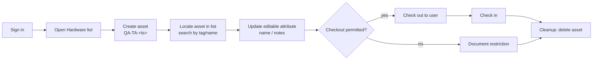

# Part 1 — Test Strategy: Snipe-IT Hardware Asset Workflow

| Item | Value |
|---|---|
| Application under test (AUT) | Snipe-IT public demo — <https://demo.snipeitapp.com> |
| Module | Hardware / Assets — <https://demo.snipeitapp.com/hardware> |
| API | Snipe-IT REST API v1 — `https://demo.snipeitapp.com/api/v1` |
| Demo credentials | `admin` / `password` (published on the Snipe-IT demo page) |
| Author | QA candidate                                               |
| Framework (Part 2+) | Playwright + TypeScript (UI, API, integration, E2E in one runner) |
| CI | GitLab CI |

## 1. Workflow under test

One coherent workflow, end to end:

## 2. Scope

### In scope

- Authentication needed to reach the workflow (UI form login, API Bearer token).
- Asset **create** (required fields: model, status, asset tag; optional: name, serial, notes, location).
- Asset **list/search/filter** and **detail** view.
- Asset **update** of safe attributes (`name`, `notes`).
- Asset **checkout** to a user and **checkin** (status/assignment transitions).
- Server-side **validation** (required fields, unique asset tag, max length).
- **Permissions**: unauthenticated access, missing/invalid API token, non-admin user (if a limited account can be used).
- **Cross-layer consistency**: UI ↔ API ↔ (hypothetical) DB.

### Out of scope

- Licenses, accessories, consumables, components, reports, LDAP/SAML, email notifications, imports, label printing.
- Performance/load and security penetration testing (the demo is a shared public system; load testing it would be abusive).
- Direct database access (not provided by the demo — Part 4 is a design exercise only).
- Cross-browser beyond Chromium in CI (Firefox/WebKit run on demand; see §7).

## 3. Highest risks (ranked)

| # | Risk | Impact | Likelihood | Mitigation in tests |
|---|---|---|---|---|
| R1 | **Edits silently not persisted / UI shows stale value** (API or form returns success, data unchanged) | High — wrong inventory, audit failures | Medium | Assert after **reload/revisit**, and re-read via API (`GET /hardware/{id}`), not just on the success banner |
| R2 | **API returns HTTP 200 for validation errors** (Snipe-IT docs list a "200 validation error" response) — clients that check only status codes treat failures as success | High | High | API assertions always check body `status` (`success`/`error`) and `messages`, never status code alone |
| R3 | **Checkout/checkin state corruption** (status, `assigned_to`, location not updated together; asset double-assigned) | High | Medium | Assert status label, assignee and history entry after each transition, in UI and API |
| R4 | **Duplicate asset tags** accepted (UI, API, race between concurrent creates) | High — breaks tracking | Low–Medium | Negative test for duplicate tag; SQL duplicate check (Part 4) |
| R5 | **Permission leaks** (unauthenticated or under-privileged user can create/update) | High | Low | Unauth redirect test, 401 without token, non-admin case if an account is available |
| R6 | **Shared public demo**: other users edit/delete data, periodic resets, rate limits, demo-mode restrictions | Test reliability (not product) | High | Unique run-scoped data, never touch records we didn't create, resolve lookup IDs at runtime, retries with traces, documented limitations |
| R7 | **Async UI widgets** (Select2 dropdowns, AJAX-loaded bootstrap-table list) cause flaky automation | Test reliability | High | Web-first assertions and waits on network responses; no fixed sleeps |

## 4. Test levels and manual vs. automated coverage

| Level | What | Automated? | Why |
|---|---|---|---|
| API | Read list/detail, schema/field checks, auth negatives, create/update/checkout/checkin, validation | **Yes** | Fast, stable, gives the oracle for UI tests |
| UI | Login, create, search, edit, validation errors, checkout/checkin | **Yes** (critical paths) | Covers what the user actually sees |
| Integration (cross-layer) | API create → UI shows it; UI edit → API returns it | **Yes** | Catches R1/R2 class defects |
| E2E | Full workflow §1 in one test | **Yes** (1–2 flows) | Release smoke |
| Exploratory | Odd inputs, navigation, history/audit log, UX copy, accessibility spot checks | **Manual** | Judgment-heavy, low repeatability value |
| Visual / layout, responsive | Table layout, mobile view | **Manual** | Volatile, low ROI on a shared demo |
| Permissions with custom roles | Requires creating users/groups on shared demo | **Manual / controlled env** | Avoid mutating global permission data on the public demo |
| DB integrity | Duplicate tags, counts by status, recent updates | **Design only** (Part 4) | No DB access on demo |

## 5. Test data strategy

- **Unique, run-scoped identifiers**: `QA-TA-<yyyyMMddHHmmss>-<rand4>` for asset tag and name prefix, so parallel runs and other candidates never collide.
- **Create what you need, clean what you create**: each test creates its own asset through a fixture (API when a token is available, UI otherwise) and deletes it in teardown. Tests never modify pre-existing demo records.
- **Lookups resolved at runtime**: model, status label ("Ready to Deploy"), location and checkout user are found by **name** at run start (API or UI), never hard-coded IDs, because the demo resets and IDs can change.
- **Static input data** lives in `test-data/*.json` (boundary strings, invalid inputs); **dynamic data** is generated by a factory in code.
- Full data/env catalogue: [`05-test-data-and-environment.md`](05-test-data-and-environment.md).

## 6. Regression priorities

| Priority | Suite | Contents | When it runs |
|---|---|---|---|
| **P1 — Smoke** | `@smoke` | Login, list loads, create, find, edit persists, API read + auth negative | Every MR/commit, ~3–5 min |
| **P2 — Core regression** | `@regression` | Validation (required, duplicate, boundary), checkout/checkin, cross-layer checks | Merge to main, nightly |
| **P3 — Extended** | `@extended` | Permissions with non-admin, special characters, cross-browser | Nightly / before release |

Release gate: P1 + P2 must be green (retried-then-passed tests are reported as **flaky** and reviewed, not silently accepted).

## 7. Environments and execution

| Env (`TEST_ENV`) | URL | Use |
|---|---|---|
| `demo` (default) | `https://demo.snipeitapp.com` | This assessment |
| `local` | `http://localhost:8000` (Snipe-IT Docker) | Controlled env: DB access, API token, permission tests, safe cleanup |
| `staging` | `${BASE_URL}` | Team environment |

- Browsers: Chromium in CI; Firefox and WebKit via `--project`.
- Parallelism: tests are independent (own data, own session) so they can run in parallel; workers limited to 2 on the public demo to be a polite client.

## 8. Flakiness and rerun policy

- Playwright `retries`: 0 locally, 2 in CI. Trace, screenshot and video kept **on first retry / on failure**.
- A test that passes only after retry is marked **flaky** in the report and a ticket is opened; it does not silently turn green.
- GitLab has a separate manual/automatic **rerun-failed** job (`npx playwright test --last-failed`) for reruns without re-running the whole suite.
- Known-unstable tests can be tagged `@quarantine` and run in a non-blocking job until fixed (time-boxed).
- Root-cause before retry: distinguish *environment* (demo reset, network, rate limit) from *test* (locator, timing) from *product* (real intermittent bug — e.g. the Part 6 assignment-save issue). Retries must never hide a product failure.

## 9. Entry and exit criteria

**Entry**: demo reachable; admin login works; at least one asset model, one deployable status label and one user exist; API token available (or limitation documented).

**Exit**: all P1/P2 test cases executed; no open Critical/High defects in the workflow; flaky tests triaged; limitations and skipped cases documented in the summary.

## 10. Assumptions and constraints

- The demo is shared and resets periodically; data created by others may appear in lists. Assertions target **our own** identifiers only.
- Demo mode may block some actions (e.g. generating API tokens, deleting, changing settings). Any blocked step is documented, not bypassed — as the assessment requires.
- Field behaviours (max lengths, auto-increment asset tag, exact error copy) are taken from Snipe-IT's published API reference and validation rules, and are confirmed against the live demo when the automation first runs (Part 2). Any mismatch will be recorded as a finding.

## 11. Tooling and AI disclosure

- Playwright Test (TypeScript), ESLint + Prettier, dotenv, GitLab CI, Playwright HTML/JUnit reporters.
- AI assistance (Claude) was used to draft documentation and scaffolding. All test cases, endpoints and expected results are reviewed against the official Snipe-IT API reference and verified by running against the demo before submission.
