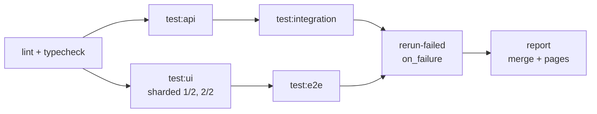

# Automation Plan & Framework Design

What will be automated (Parts 2–3), how the framework is structured, and the policies for sessions, data, cleanup and reruns.

## 1. What is automated, by layer

| Spec file (planned) | Layer | Covers | Tags |
|---|---|---|---|
| `tests/ui/auth.spec.ts` | UI | TC-01, TC-09 (UI) | `@smoke` |
| `tests/ui/asset-create.spec.ts` | UI | TC-02, TC-03 | `@smoke` |
| `tests/ui/asset-update.spec.ts` | UI | TC-04 | `@smoke` |
| `tests/ui/asset-validation.spec.ts` | UI | TC-05, TC-06 (UI) | `@regression` |
| `tests/ui/asset-checkout.spec.ts` | UI | TC-08 | `@regression` |
| `tests/api/hardware-read.spec.ts` | API | list/detail read, schema & field assertions | `@smoke` |
| `tests/api/hardware-auth.spec.ts` | API | TC-09 (401 no/invalid token) | `@smoke` |
| `tests/api/hardware-write.spec.ts` | API | create/update, TC-06 (API), TC-07 | `@regression` |
| `tests/integration/api-ui-sync.spec.ts` | X | TC-10 | `@regression` |
| `tests/e2e/asset-lifecycle.spec.ts` | E2E | Full §1 workflow in one test | `@smoke @e2e` |

Not automated (manual): exploratory, visual/responsive, non-admin role setup on the public demo.

## 2. Framework architecture

```text
snipeit-qa-automation/
├── playwright.config.ts        # projects: setup, ui-chromium, api, integration, e2e; retries; reporters
├── .env.example                # all env vars (copy to .env)
├── .gitlab-ci.yml              # lint → typecheck → api → ui → e2e → rerun-failed → report
├── eslint.config.mjs / .prettierrc
├── src/
│   ├── config/env.ts           # typed, validated env loading (fails fast on missing vars)
│   ├── pages/                  # Page Objects (POM)
│   │   ├── BasePage.ts         # shared waits, alerts, navigation helpers
│   │   ├── LoginPage.ts
│   │   ├── HardwareListPage.ts # search, table rows, wait for bootstrap-table load
│   │   ├── AssetFormPage.ts    # create/edit form, Select2 helpers, field errors
│   │   ├── AssetDetailPage.ts  # read values, history tab, checkout/checkin buttons
│   │   └── CheckoutPage.ts / CheckinPage.ts
│   ├── api/
│   │   ├── ApiClient.ts        # Bearer auth, JSON headers, body status/error unwrapping
│   │   ├── HardwareApi.ts      # list/get/bytag/create/patch/delete/checkout/checkin
│   │   ├── LookupApi.ts        # models, statuslabels, users, locations by name
│   │   └── schemas/            # JSON schema / zod for response validation
│   ├── fixtures/
│   │   ├── test.ts             # extended `test` with fixtures below
│   │   ├── auth.setup.ts       # logs in once → storageState (.auth/admin.json)
│   │   └── data.ts             # testAsset fixture: create → yield → delete
│   └── utils/
│       ├── testData.ts         # QA-TA-<ts>-<rand> generator, asset factory
│       ├── cleanup.ts          # registry of created IDs + sweeper for this RUN_ID
│       └── logger.ts
├── tests/{ui,api,integration,e2e}/
├── test-data/                  # static JSON fixtures (boundary + invalid inputs)
├── sql/                        # SQL verification queries (Part 4)
└── docs/
```

### Design rules

- **POM**: pages expose intent-level methods (`createAsset(data)`, `search(tag)`, `editNotes()`); **assertions stay in specs**, except reusable `expect…` helpers for repeated checks.
- **Locators** (priority): `getByRole`/`getByLabel` → stable `id`/`name` attributes (`#asset_tag`, `[name="name"]`) → scoped CSS. No XPath on layout, no nth-index without scoping.
- **Waits**: web-first `expect(...).toBeVisible()/toHaveText()`, `page.waitForResponse()` for AJAX table loads and Select2 searches. **No `waitForTimeout`** (ESLint rule `playwright/no-wait-for-timeout`).
- **Reusable functions**: one helper for Select2 selection (`selectFromSelect2(field, text)`), one for alert reading, one for table search — used by every page.
- **Typed config**: everything environment-specific comes from `src/config/env.ts`; no URLs/credentials in specs.

## 3. Preconditions, sessions and cookies

| Concern | Approach |
|---|---|
| Login once, reuse | `setup` project runs `auth.setup.ts` → saves `storageState` to `.auth/admin.json` (git-ignored); UI projects depend on it. |
| Isolation per test | Each test gets a **new browser context** (Playwright default) → cookies/localStorage isolated. |
| Logged-out tests | `test.use({ storageState: { cookies: [], origins: [] } })` + `context.clearCookies()` for TC-01/TC-09. |
| Session expiry / demo reset | Setup re-runs on each run; a fixture detects redirect to `/login` and fails with a clear "session invalid / demo reset" message rather than a locator timeout. |
| API auth | `Authorization: Bearer ${SNIPEIT_API_TOKEN}`, `Accept: application/json`, `Content-Type: application/json`. If token is absent, API/integration projects are **skipped with a reason**, not failed. |
| Lookups | `globalSetup` resolves model/status/user/location IDs by name (API or UI) and caches them in `.cache/lookups.json` for the run. |

## 4. Test data and cleanup

- `testAsset` fixture: builds data via factory → creates via API (fallback UI) → registers id in cleanup registry → yields `{id, tag, name}` → deletes in teardown (checks in first if checked out).
- Teardown runs even if the test fails (`fixture` teardown semantics).
- `globalTeardown` sweeper: finds assets whose tag starts with `${TEST_PREFIX}-` **and** contains this `RUN_ID`, deletes leftovers. It never touches other data.
- `CLEANUP=false` keeps data for debugging.
- If delete is blocked by the demo, the test logs the leftover tag and the summary documents it.

## 5. Rerun mechanism for flaky / failed tests

| Mechanism | Config |
|---|---|
| Automatic retry | `retries: process.env.CI ? 2 : 0` |
| Evidence | `trace: 'on-first-retry'`, `screenshot: 'only-on-failure'`, `video: 'retain-on-failure'` |
| Rerun only failures | `npm run test:rerun` → `playwright test --last-failed` (uses `test-results/.last-run.json`); GitLab job `rerun-failed` (when: on_failure / manual) |
| Flaky visibility | HTML + JUnit reports show "flaky" status; CI summary prints flaky count. |
| Quarantine | `@quarantine` tag excluded from blocking jobs (`--grep-invert @quarantine`), run in `allow_failure` job |
| Fail fast on infra | Health-check in `globalSetup` (demo reachable, login works) — aborts with clear message instead of 50 timeouts |

## 6. GitLab CI pipeline (planned)



- Image: `mcr.microsoft.com/playwright:v<version>-noble` (browsers preinstalled).
- Secrets as masked CI/CD variables: `SNIPEIT_PASSWORD`, `SNIPEIT_API_TOKEN`.
- Artifacts: `playwright-report/`, `test-results/`, `junit.xml` (GitLab test report widget).
- Schedules: nightly full regression; MR pipelines run `@smoke`.

## 7. Static quality

- ESLint (typescript-eslint + eslint-plugin-playwright): no focused tests, no fixed waits, no floating promises, `expect` required in tests.
- Prettier formatting; `tsc --noEmit` typecheck; Husky pre-commit optional.
